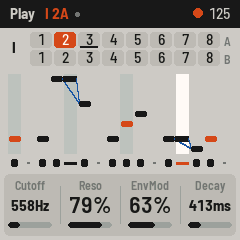
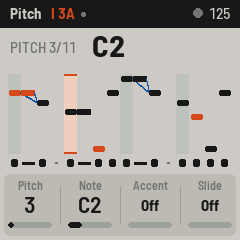
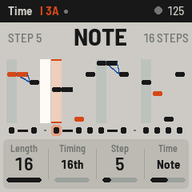
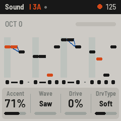

# FM-303 for the M-VAVE FM-1

FM-303 turns the M-VAVE FM-1 into a TB-303-style bass line synthesizer: one 303 voice and the
303's own sequencer, with patterns written the 303 way, in **pitch mode** and **time mode**, with
accent, slide and tie, four pattern groups of sixteen, cueing and chains, and MIDI clock in and out.

   

> **Status: milestone 1, not yet run on an FM-1.** The firmware is complete enough to build, and the
> whole app (UI, sequencer, sound) runs and is tested in the host simulator, but no FM-1 has
> booted it yet. Building the installable package needs JieLi's toolchain and SDK (see
> [BUILDING.md](BUILDING.md)). Don't flash it expecting a finished instrument.

How the FM-1 custom firmwares work, and where FM-303 comes from:
[docs/RESEARCH.md](docs/RESEARCH.md). How FM-303 works inside, and what comes next:
[docs/DESIGN.md](docs/DESIGN.md).

## Playing

The buttons that pick a view light up. Every view has four values on KNOB 1–4, shown at the
bottom of the screen.

| | |
|---|---|
| **HOME** | **PLAY.** White keys pick a pattern of the group: 1A–8A, then 1B–8B. While playing, it starts at the end of the pattern playing. Hold one white key and press another to chain the two and everything between. Black keys 1–4 pick the group (I–IV). KNOB 1–4: Cutoff, Reso, EnvMod, Decay. |
| **SEQ** | **PITCH** (the 303's pitch mode). Each key writes the next note of the pattern. Hold ENV for an accent and LFO for a slide. Tapped alone, ENV and LFO flip the accent or slide at the cursor. KNOB 1 the cursor, 2 its note, 3 accent, 4 slide. |
| **SEQ** again | **TIME** (the 303's time mode). The white keys are the 16 steps: a tap turns a step NOTE → TIE → REST. Tapping past the end makes the pattern longer. Black keys 1, 2 and 3 write NOTE, TIE and REST at the cursor and move on. KNOB 1 length, 2 sixteenths or triplets, 3 the cursor, 4 the step. |
| **FX** | **SOUND**: Accent, Wave (saw / square), Drive, Drive type (off / soft / RAT) |
| **SEL** | **MORE**: Tune, Volume, Slide time, Accent decay |
| **GLO** | **SETUP**: MIDI channel, Note out, Clock out, Lights |
| **EDIT** | the next view |
| **PLAY** | start / stop |
| **ARP** | KEYS: on PLAY, the keyboard plays the 303 instead of picking patterns. While a pattern plays, a key transposes it from C4. On SOUND, MORE and SETUP the keyboard always does this. |
| **OCT− / OCT+** | the keyboard's octave (the 303's DOWN / UP). The C4 key plays the 303's C (C2). |
| **REC** | on PITCH / TIME: the cursor back to step 1 |
| **SELECT** | tempo |
| **ALGORITHM** | accent amount |
| **PRESETS** | the pattern, through all 64 |
| **SAVE** | saves the patterns and the sound. Held with a white key on PLAY: copies the pattern there. Held with REC (twice) on PITCH / TIME: clears the pattern. FM-303 also saves by itself a few seconds after a change, while stopped. |
| **OCT− + OCT+** | held 5 s: update mode. Held at power-on: hardware calibration (both from Felucca) |

The 303's way of writing a pattern: in PITCH, play the notes of the riff in order (accents and
slides as you go). Then in TIME, decide which steps take a new note, which tie the note before,
and which rest. Each NOTE step takes the next pitch. Change the time line and the same notes make
a new riff.

Group I starts with eight patterns to play with (5A is in triplets). The others start as the
303's cleared pattern.

**MIDI** (USB, class compliant; the TRS jack is an input): clock, start and stop in are followed.
Notes in on the MIDI channel play the 303 while stopped (velocity 100 and up is an accent, a note
over a held one slides) and transpose the pattern while playing. Out: the sequencer's notes and
clock with start / stop.

## Building and testing

The whole app runs on a computer in the simulator, which is where it is tested:

```
tests/run_tests.sh                       # unit tests, the sequencer, the app in the simulator
build/host/fm303_host SCRIPT OUTDIR      # run a script (tests/scenarios/*.f303): WAV + PNG out
tests/host/run_bass303.sh                # the 303 voice against Open303 (needs schwung-303)
```

The firmware itself needs JieLi's toolchain and three files from its AC79 SDK:

```
./build.sh                               # build/fm303.fwsc
python3 tools/fm1_install.py build/fm303.fwsc
```

Details, and how to get back to M-VAVE's firmware: [BUILDING.md](BUILDING.md).

## Credits and licence

FM-303 is built on [Felucca](https://github.com/hugelton/Felucca) by Leo Kuroshita (Hügelton
Instruments), by way of Charles Vestal's [X0X](https://github.com/charlesvestal/fm1-x0x) and
[FoMni](https://github.com/charlesvestal/fm1-fomni). Its platform (hardware layer, USB, update
loader, storage, installers) is Felucca's. The 303 voice is X0X's port of Robin Schmidt's
Open303 (MIT) with the drive of schwung-303. The sequencer, engine and UI are FM-303's own.
GPL-3.0-only; see [LICENSING.md](LICENSING.md).

TB-303 is a trademark of Roland. M-VAVE and FM-1 are trademarks of their owners. FM-303 is not
affiliated with or endorsed by Roland, M-VAVE, Hügelton Instruments or the X0X / FoMni author.
