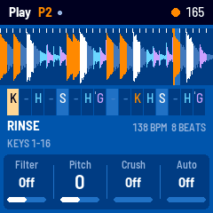
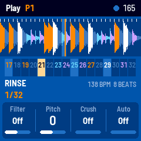
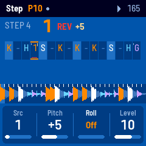
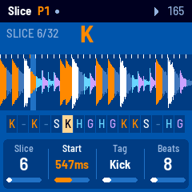
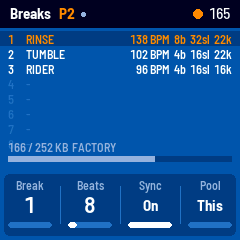
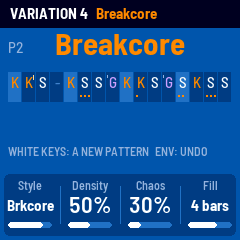
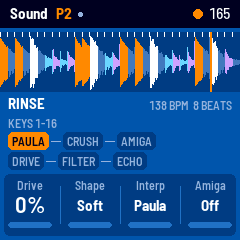

# CHOPPAGE for the M-VAVE FM-1

CHOPPAGE turns the M-VAVE FM-1 into a break chopper for jungle and breakcore. A drum break is cut into
slices, and every slice is tagged **kick**, **snare**, **hat** (hats and rides) or **ghost**. A pattern
places either a particular slice or a **type** on a step. A type step plays a random slice of that type
each time, like a bank of snares or a bank of kicks from an Amen or a Funky Drummer. Under your fingers
are beat repeats, reverse and tape stop, and the break always comes back in time. A **generator**
writes chops in a style and **AUTO** varies the pattern every bar, with fills. Playback is 8-bit in the
Amiga way: Paula-style (no interpolation), ProTracker sample rates, and the A500 and LED output filters.

   
  

> **Status: first version, not yet run on an FM-1.** The firmware builds with JieLi's toolchain and
> passes every check of the platform's build. The whole app (engine, UI, break store, loading over
> SysEx) runs and is tested in the host simulator. No FM-1 has booted it yet. See
> [docs/DESIGN.md](docs/DESIGN.md#what-needs-the-device) for what only the device can show.

CHOPPAGE is a separate firmware from FM-303, which lives in the same repository. It shares only
Felucca's platform layer (hardware, USB, update loader, storage, installers) and none of FM-303's
instrument code.

## The idea

A break is a loop of a drummer playing: 1, 2 or more bars. CHOPPAGE cuts it into slices (sixteenths
by default, moved onto the hits it finds), then listens to each slice and tags it. You can change both
on the FM-1 (**EDIT**).

A **step** of a pattern plays one of:

| On the step | It plays |
|---|---|
| `-` | nothing new: the slice before **plays on** through the break, as a tracker's sample offset does |
| `K` `S` `H` `G` | a **type**: a slice tagged kick, snare, hat or ghost, picked at random. **Vary** sets how often it picks a new one (0: each step keeps its own; 100: a new one every time). **Pool: All** picks from every break loaded |
| `?` | any slice |
| `1`..`32` | that slice |
| `X` | cut: silence |

Each step also has a **pitch** (±24), a **roll** (2, 3, 4, 6, 8, 12 or 16 retriggers in the step, the
roll climbing or falling an octave with **Ramp**), **reverse**, a **level**, a **chance** to play, and a
**gate** (play on, or stop after 1/8..8/8 of the step).

With **Sync** on (the default), the playback rate follows the tempo, so the break stays in time:
pitch is speed. A break of 136 BPM at 165 plays faster and higher, which is the jungle sound. With
Sync off, the break keeps its pitch and the steps chop it.

A pattern written in types suits any tagged break. Change the break (**ALGORITHM**) and the same
chop plays with other drums.

## Playing

The buttons that pick a view light up. KNOB 1–4 do what the bottom of the screen shows. A view's
button pressed again opens its second page (the button blinks).

| | |
|---|---|
| **HOME** | **PLAY**. White keys play the break's slices (OCT−: 1–16, OCT+: 17–32). While the pattern runs, a slice held **takes over** (the break plays on from it) and the pattern comes back **in time** when you let go (Keys: Replace; with Layer they play on top). Black keys are the **perform** effects (below). ENV + white key: the pattern (cued to the end of this one). LFO + white key 1–8: the break. KNOB: Filter, Pitch, Crush, Auto |
| **SEQ** | **STEP**. White keys are the steps (OCT for 17–32). A tap picks a step and plays it. **Hold a black type key and tap steps** to paint them (tap again to clear). A black key alone writes at the picked step: K S H, G ?, REV ROLL PITCH, clear CUT, the slice played last. KNOB: Src, Pitch, Roll, Level; again: Rev, Ramp, Chance, Gate |
| **EDIT** | **SLICE**. White keys play and pick slices; black keys tag them K S H, G, none. KNOB: Slice, Start (ms), Tag, Beats; again: Cut (Auto / 8 / 16 / 32 / Hits), Sens, Snap. A new cut is made at once. **REC**: the tags again, by ear |
| **SEL** | **BREAKS**: the breaks loaded, their tempo and length. White keys 1–8 pick one. KNOB: Break, Beats, Sync, Pool |
| **ARP** | **GEN**. White keys write a new pattern in the style; each key has its own dice. Black keys 1–6 pick the style (Straight, Jungle, Roller, Halftime, Breakcore, Tracker), the last one rolls new dice. **ENV** takes the last one back. KNOB: Style, Density, Chaos, Fill; again: Length, Vary, Swing, Ramp |
| **FX** | **SOUND**: Drive, Shape (soft / hard / fold), Interp (Paula / Clean), Amiga (off / A500 / A500+LED / LED); again: Echo, Time, Feedback, Reso |
| **GLO** | **SETUP**: MIDI channel, Clock out, Note out, Lights; again: Quant (off / 1/16 / 1/32), Keys (Replace / Layer), Rec as (Slice / Type), Volume. It shows the audio load |
| **PLAY** | start / stop |
| **REC** | record: what the keys play goes into the pattern, on the step it lands on (quantized). **Rec as Type** writes the slice's tag, so the take plays random hits of the same kind |
| **SELECT** | tempo |
| **ALGORITHM** | the break |
| **PRESETS** | the pattern (16), cued to the end of the one playing |
| **SAVE** | saves patterns, slices and settings. Held with a white key on PLAY: copies the pattern there. Held with REC (twice) on STEP: clears the pattern. CHOPPAGE also saves by itself a few seconds after a change, while stopped |
| **OCT− + OCT+** | held 5 s: update mode. Held at power-on: hardware calibration (both from Felucca) |

### The black keys on PLAY (held)

| F#3 | G#3 | A#3 | C#4 | D#4 | F#4 | G#4 | A#4 | C#5 | D#5 | F#5 |
|---|---|---|---|---|---|---|---|---|---|---|
| repeat 1/8 | 1/16 | 1/32 | 1/64 | 1/24 (triplet) | **reverse** | **tape stop** | **octave down** | **beat repeat** (1/4) | **gate** (1/32 stutter) | **scatter** |

A repeat starts on its own grid (a 1/32 on the next 1/32) and plays what was playing over and over,
the sequence running on underneath. Hold two, and the last one wins. **Ramp** (GEN, second page)
makes repeats climb or fall in pitch. Let go of any of them and the break is back where it would be.
Scatter plays random slices, rolls and reverses for as long as it is held. They combine: hold 1/32
with reverse and octave down.

### AUTO and fills

**Auto** (PLAY, KNOB 4) lets the generator vary the pattern every bar, in the style chosen on GEN:
other slices of the same kind, rolls, reverses, stutters, pitch jumps. The written pattern stays as
it is. **Fill** puts a fill on the last beat every 2, 4 or 8 bars, such as a snare roll that speeds
up and climbs or a reversed snare. The bars it varies show "VARIED" on PLAY.

### The factory patterns

1 the break straight (two bars) · 2 two-step in types · 3 the classic chop (a bar straight, then
the first half again and rolled snares) · 4 roller · 5 halftime · 6 breakcore · 7 ragga (reversed
snares into the backbeat) · 8 tracker jumps · 9 an Amen-style edit in types · 10 stepper · 11 sparse
(room for the echo) · 12 gabber-ish, pitched down. 13–16: the break straight, one bar.

### MIDI

USB (class compliant) and the TRS jack. In: clock, start and stop are followed. Notes on the MIDI
channel from C2 (36) play slices 1, 2, ... (velocity is the level). A program change cues the
pattern. Out: clock with start and stop on the own tempo (Clock out), and a note for each slice the
pattern plays (Note out).

## Loading breaks

Three breaks come with CHOPPAGE, synthesized when it starts (no sampled audio ships): **RINSE** (two
bars, 138 BPM), **TUMBLE** (one bar, 102 BPM, swung hats) and **RIDER** (one bar, 96 BPM, at
ProTracker's 16574 Hz). The first break you load replaces them.

Up to 8 breaks, 252 KB in all, at 8 bits a sample: a two-bar break at 22 kHz is about 75 KB.
From a computer, over the USB cable:

- **In the browser** (Chrome or Edge): `web/breaks.html` (also on the project's site). Drop a WAV,
  AIFF, MP3 or FLAC, pick the slot, the rate and the format, and send.
- **From the command line**: `python3 tools/chp_breaks.py load 2 amen.wav` (needs
  `pip3 install mido python-rtmidi`). `list`, `delete`, `select` and `factory` too. `--syx out.syx`
  writes the SysEx for any other SysEx tool.

Options: **rate** (8363 to 44100 Hz; lower holds more and sounds grittier), **format** (8-bit linear,
the Amiga sound, or mu-law, cleaner in the quiet parts), dither, trim, and the beats (guessed from the
length: the loop's tempo is put near 88–177 BPM). On arrival the FM-1 cuts the break and tags the
slices. Check the tags in EDIT, since the tagger is good but not perfect, and fix any by ear.

## Building and testing

```
tests/run_tests.sh                       # everything below that needs no FM-1
build/host/chp_host SCRIPT OUTDIR        # run a script (tests/scenarios/*.chp): WAV + PNG out
./build.sh                               # the firmware: build/choppage.fwsc (JieLi toolchain + SDK)
python3 tools/fm1_install.py build/choppage.fwsc
```

Details, how to go back to M-VAVE's firmware, and how to move CHOPPAGE into a repository of its own:
[BUILDING.md](BUILDING.md). How it works inside: [docs/DESIGN.md](docs/DESIGN.md).

## Credits and licence

CHOPPAGE is built on [Felucca](https://github.com/hugelton/Felucca) by Leo Kuroshita (Hügelton
Instruments), by way of Charles Vestal's [X0X](https://github.com/charlesvestal/fm1-x0x) and
[FoMni](https://github.com/charlesvestal/fm1-fomni). Its platform (hardware layer, USB, update loader,
storage, installers) is Felucca's, and the maths library (`fastmath.h`) is X0X's. The engine,
sequencer, generator, break analysis, factory breaks, break store, loaders and UI are CHOPPAGE's own.
GPL-3.0-only; see [LICENSING.md](LICENSING.md).

M-VAVE and FM-1 are trademarks of their owners. Amiga is a trademark of its owner; CHOPPAGE only
imitates the sound of its audio hardware. CHOPPAGE is not affiliated with or endorsed by M-VAVE,
Hügelton Instruments or the X0X / FoMni author.
